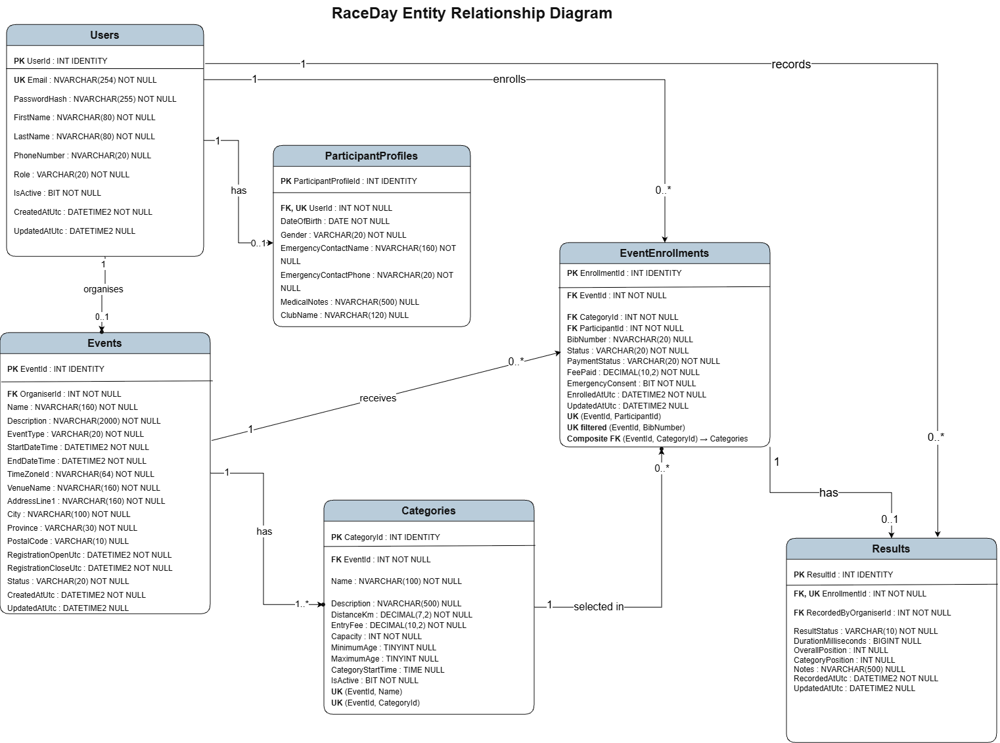

# RaceDay — South African Event Management System

RaceDay is an event management system for South Africa's running, walking and cycling community. Organisers manage events and results, while Participants browse events, enter a category and view their results. This repository contains the Part 1 planning documents and SQL script, plus the Part 2 C# ASP.NET Core Web API. The MVC interface is planned for Part 3.

## User roles

### Organiser

An Organiser can create and update their events, change event status, delete draft events, manage categories, view their event enrolments, and capture or update results. The API checks the logged-in role and event ownership before allowing these actions.

### Participant

A Participant can register, update their profile, browse available events and categories, enter an event by selecting a category, and view their own enrolments and results. Participant accounts cannot perform Organiser-only actions.

## Planning deliverables

| Deliverable | File | Purpose |
|---|---|---|
| Entity Relationship Diagram | [`docs/raceday-erd.png`](docs/raceday-erd.png) | Six-entity visual model with attributes, keys, relationships, and cardinalities. |
| ERD source | [`docs/raceday-erd.mmd`](docs/raceday-erd.mmd) | Version-controlled Mermaid source for the ERD. |
| Technical references | [`docs/references.md`](docs/references.md) | Harvard-style references for external HTTP and SQL Server conventions. |
| API endpoint plan | [`docs/endpoint-plan.md`](docs/endpoint-plan.md) | Route-by-route contract covering method, route, purpose, role, request, response, and failures. |
| SQL Server script | [`docs/raceday-database.sql`](docs/raceday-database.sql) | Creates `RaceDayDb`, tables, keys, constraints, indexes, realistic sample data, and verification checks. |

## Entity Relationship Diagram

The data model contains `Users`, `ParticipantProfiles`, `Events`, `Categories`, `EventEnrollments`, and `Results`. Unique constraints prevent duplicate event entries, duplicate event bibs, duplicate emails and multiple results for one enrolment. In the current implementation, the API checks that the selected category belongs to the event; the SQL script uses separate event and category foreign keys.

Implementation differences from the original ERD: password hashes allow 512 characters; text columns use the SQL types in the script; minimum/maximum ages use `INT`; and the event/category match is enforced in the API rather than by the composite foreign key shown in the diagram. A user may organise many events, even though the current diagram labels the Events end as `0..1`.

## Run the SQL script in SSMS

Requirements: SQL Server 2019 or later and SQL Server Management Studio (SSMS).

1. Connect SSMS to a clean local SQL Server instance using an account allowed to create databases.
2. Confirm that a database named `RaceDayDb` does not already exist on that instance. This is a first-time setup script; do not rerun it against your existing database.
3. Open [`docs/raceday-database.sql`](docs/raceday-database.sql) in SSMS.
4. Select **Execute**. Keep SQLCMD mode off; the standard `GO` batch separators are supported directly by SSMS.
5. Confirm there are no SQL errors. The final six result grids should show 4 users, 2 participant profiles, 3 events, 9 categories, 3 enrolments and 2 results.

The script ends with queries showing the seeded records. The GitHub Actions SQL job separately checks the expected user, event, category, enrolment and result counts on a clean SQL Server instance.

## Part 2 API setup and run instructions

The Part 2 ASP.NET Core Web API is in [`RaceDayApi`](RaceDayApi). It uses Entity Framework Core Code First, SQL Server, session-based authentication, Swagger, and xUnit tests.

Requirements: Visual Studio 2022 with ASP.NET development support, the .NET 6 SDK/runtime used by this project, and an accessible SQL Server instance. The default development connection uses `(localdb)\api_both` and database `RaceDayDb`. Keep the browser and API on the VM when the database is on that VM.

1. Open `RaceDay.sln` in Visual Studio 2022.
2. Set `RaceDayApi` as the startup project.
3. In `RaceDayApi/appsettings.json`, confirm the `RaceDayDatabase` connection string points to your LocalDB or SQL Server instance. Authentication uses sessions.
4. If you already created the full database with the SQL script, keep it. Do not also run the initial migration against it. For a separate new database, use the EF Core migrations to create the schema.
5. Run the API. Swagger opens at `/swagger`. Click **Try it out** to enter individual form fields. Register using the Participant/Organiser dropdown, log in using the email/password fields, then test the role-protected routes in the same browser session.
6. Run the test suite with `dotnet test RaceDay.sln`.

Registration and login use separate Swagger input boxes. Select `Participant` or `Organiser` during registration; login uses the role stored in the account. Participants must also enter their birth date, gender and emergency contact details because the current database requires them. Phone number, club and medical notes are optional profile details. Passwords are hashed before storage. The session remembers the user's ID and role until it expires or is cleared; logout clears it.

The seeded demonstration accounts include `lerato@jozievents.co.za` (Organiser) and `nomsa@example.co.za` (Participant), both with password `Password123!`. These are sample accounts for local demonstrations only.

The controllers use individual `[FromForm]` inputs, with no separate request/form classes or `[Consumes]` attributes. See the [simple code and video guide](docs/simple-code-and-video-guide.md) for explanations and replacement instructions. If you manually added `InputForms.cs` or `RegistrationDetails.cs` from an older ZIP, remove those old files when updating; this version uses `RegistrationRole.cs` for the dropdown. Do not paste new controller code below the old code.

## CI/CD validation

Repository: [SilvestreFirmino/PRG6212-RDay-Part-2](https://github.com/SilvestreFirmino/PRG6212-RDay-Part-2).

The GitHub Actions workflow runs on every push and pull request to `main`. It performs two independent checks:

1. validates the required repository files, PNG signature, six SQL entities, endpoint-plan coverage, README content, and minimum 20-commit history; and
2. starts a clean SQL Server 2022 container, executes the complete script with error-stop behaviour, and verifies the expected user, event, category, enrolment and result counts.

The separate API workflow restores dependencies, builds the solution and runs the unit tests when API, test, solution or workflow files change. The unit tests use an in-memory database; the clean SQL job tests the SQL script against SQL Server. Run `pwsh ./scripts/validate-repository.ps1` locally to check repository structure.

The screenshot below is retained from the earlier planning validation. Use the workflow badges above to check the latest runs; this image does not establish that the latest Part 2 API build passed.

[View the earlier planning validation run](https://github.com/SilvestreFirmino/PRG6212-RDay-Part-2/actions/runs/33749453678).

## Video walkthrough

**Unlisted YouTube video:** [Watch the RaceDay Part 1 walkthrough](https://youtu.be/imDPdiAGPVE)

**Part 2 YouTube demonstration:** [Watch the RaceDay Part 2 API walkthrough](https://youtu.be/x1v-uPUyrsM)

The Part 1 link covers planning; the Part 2 link is the API demonstration submitted for this assessment. The [simple code and video guide](docs/simple-code-and-video-guide.md) explains the code and demonstration steps.

## Submission checklist

- [x] ERD PNG stored in `/docs`.
- [x] Endpoint plan stored in `/docs`.
- [x] SQL Server script stored in `/docs`.
- [x] At least 20 meaningful commits.
- [x] GitHub Actions structure and clean SQL Server validation workflow.
- [x] Successful CI/CD screenshot embedded above.
- [x] Unlisted YouTube walkthrough link added.
- [x] Add the separate Part 2 YouTube demonstration link.
- [ ] Add a screenshot of the latest successful Part 2 API build and tests.
- [ ] Final GitHub repository link submitted on ARC.
